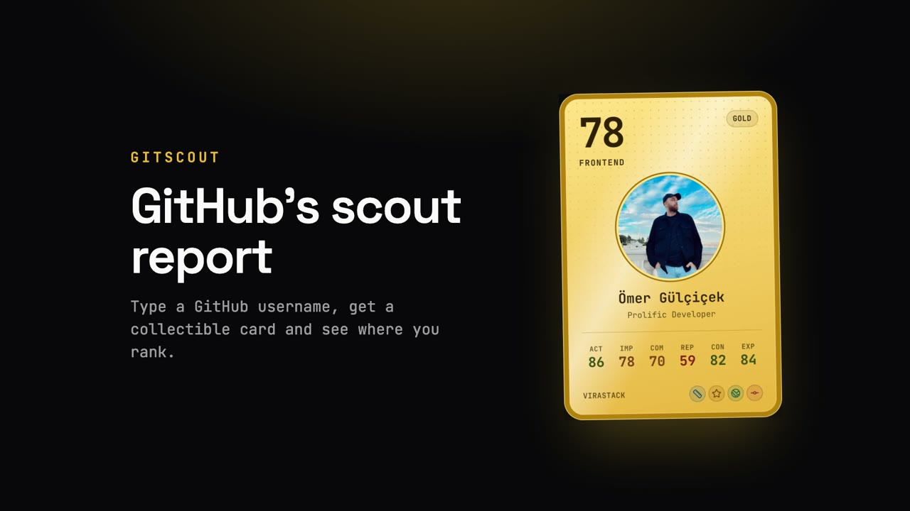

# Gitscout

**Turn any GitHub profile into a collectible card and see where it ranks.**

Type a GitHub username and Gitscout reads the public profile: contributions, repos, stars, followers and merged pull requests. A few seconds later you get a card with an overall rating, six stats, a role and a spot on the leaderboard.

- **Six stats:** Activity, Impact, Community, Reputation, Consistency and Experience, each from 0 to 100.
- **Card tiers:** Icon (90+), Gold (75–89), Silver (65–74), Bronze (0–64).
- **Role, title and badges:** Your role comes from the languages you use; your title from your strongest stat.
- **Duels:** Pick two developers and compare them stat by stat.

Scores come from simple formulas, not AI. They measure visible GitHub activity, not how good a developer is.

## Top 100

The 100 highest-rated developers on Gitscout, refreshed every day from [the leaderboard](https://gitscout.io/leaderboard). ACT: Activity, IMP: Impact, COM: Community, REP: Reputation, CON: Consistency, EXP: Experience.

<!-- LEADERBOARD:START -->
<!-- prettier-ignore-start -->
| # | Developer | | OVR | Tier | Role | ACT | IMP | COM | REP | CON | EXP |
|--:|:--|:-:|--:|:--|:--|--:|--:|--:|--:|--:|--:|
| 1 |  [sindresorhus](https://gitscout.io/u/sindresorhus) | 🇳🇴 | **95** | Icon | Frontend | 92 | 99 | 93 | 95 | 93 | 97 |
| 2 |  [mitchellh](https://gitscout.io/u/mitchellh) |  | **95** | Icon | Backend | 98 | 92 | 88 | 95 | 99 | 98 |
| 3 |  [kentcdodds](https://gitscout.io/u/kentcdodds) | 🇺🇸 | **95** | Icon | Frontend | 98 | 90 | 89 | 98 | 96 | 96 |
| 4 |  [JakeWharton](https://gitscout.io/u/JakeWharton) |  | **95** | Icon | Mobile | 93 | 94 | 92 | 98 | 92 | 97 |
| 5 |  [fabpot](https://gitscout.io/u/fabpot) | 🇫🇷 | **94** | Icon | Backend | 99 | 88 | 86 | 99 | 99 | 99 |
| 6 |  [bradfitz](https://gitscout.io/u/bradfitz) | 🇺🇸 | **93** | Icon | Backend | 96 | 91 | 86 | 96 | 96 | 98 |
| 7 |  [taylorotwell](https://gitscout.io/u/taylorotwell) | 🇺🇸 | **93** | Icon | Backend | 98 | 95 | 89 | 88 | 93 | 99 |
| 8 |  [Rich-Harris](https://gitscout.io/u/Rich-Harris) | 🇬🇧 | **92** | Icon | Frontend | 89 | 93 | 87 | 97 | 88 | 97 |
| 9 |  [paulirish](https://gitscout.io/u/paulirish) |  | **92** | Icon | Frontend | 92 | 90 | 89 | 94 | 91 | 94 |
| 10 |  [dhh](https://gitscout.io/u/dhh) | 🇩🇰 | **92** | Icon | Systems | 98 | 90 | 89 | 89 | 93 | 92 |
| 11 |  [JoshuaKGoldberg](https://gitscout.io/u/JoshuaKGoldberg) | 🇺🇸 | **91** | Icon | Frontend | 95 | 88 | 80 | 98 | 94 | 96 |
| 12 |  [torvalds](https://gitscout.io/u/torvalds) | 🇫🇮 | **91** | Icon | Systems | 91 | 97 | 99 | 76 | 96 | 96 |
| 13 |  [addyosmani](https://gitscout.io/u/addyosmani) | 🇮🇪 | **91** | Icon | Frontend | 90 | 94 | 91 | 89 | 90 | 94 |
| 14 |  [gregberge](https://gitscout.io/u/gregberge) |  | **90** | Icon | Frontend | 95 | 89 | 78 | 94 | 92 | 97 |
| 15 |  [anonrig](https://gitscout.io/u/anonrig) | 🇹🇷 | **90** | Icon | Frontend | 97 | 86 | 79 | 96 | 97 | 93 |
| 16 |  [steven-tey](https://gitscout.io/u/steven-tey) |  | **90** | Icon | Frontend | 96 | 90 | 83 | 92 | 96 | 87 |
| 17 |  [yyx990803](https://gitscout.io/u/yyx990803) | 🇨🇳 | **90** | Icon | Frontend | 88 | 87 | 94 | 86 | 98 | 97 |
| 18 |  [shadcn](https://gitscout.io/u/shadcn) |  | **90** | Icon | Frontend | 89 | 93 | 87 | 91 | 87 | 92 |
| 19 |  [fatih](https://gitscout.io/u/fatih) | 🇹🇷 | **90** | Icon | Backend | 93 | 89 | 85 | 89 | 90 | 95 |
| 20 |  [LeaVerou](https://gitscout.io/u/LeaVerou) | 🇬🇷 | **90** | Icon | Frontend | 92 | 88 | 87 | 89 | 92 | 95 |
| 21 |  [egoist](https://gitscout.io/u/egoist) |  | **90** | Icon | Frontend | 94 | 91 | 86 | 86 | 91 | 92 |
| 22 |  [rakyll](https://gitscout.io/u/rakyll) | 🇹🇷 | **90** | Icon | Backend | 92 | 89 | 86 | 90 | 87 | 94 |
| 23 |  [ThePrimeagen](https://gitscout.io/u/ThePrimeagen) |  | **90** | Icon | Frontend | 95 | 89 | 90 | 84 | 90 | 92 |
| 24 |  [swyxio](https://gitscout.io/u/swyxio) | 🇸🇬 | **89** | Gold | Frontend | 96 | 87 | 84 | 89 | 93 | 90 |
| 25 |  [mbostock](https://gitscout.io/u/mbostock) |  | **89** | Gold | Frontend | 88 | 86 | 88 | 92 | 91 | 97 |
| 26 |  [tannerlinsley](https://gitscout.io/u/tannerlinsley) |  | **89** | Gold | Frontend | 93 | 88 | 86 | 87 | 93 | 93 |
| 27 |  [gaearon](https://gitscout.io/u/gaearon) | 🇷🇺 | **89** | Gold | Frontend | 82 | 90 | 93 | 97 | 79 | 98 |
| 28 |  [privatenumber](https://gitscout.io/u/privatenumber) |  | **89** | Gold | Frontend | 99 | 87 | 81 | 87 | 99 | 91 |
| 29 |  [RobinMalfait](https://gitscout.io/u/RobinMalfait) |  | **89** | Gold | Frontend | 93 | 92 | 78 | 91 | 89 | 94 |
| 30 |  [rafaelfranca](https://gitscout.io/u/rafaelfranca) |  | **89** | Gold | Backend | 92 | 89 | 81 | 91 | 86 | 98 |
| 31 |  [aidenybai](https://gitscout.io/u/aidenybai) |  | **89** | Gold | Frontend | 99 | 90 | 83 | 85 | 99 | 87 |
| 32 |  [huozhi](https://gitscout.io/u/huozhi) |  | **89** | Gold | Frontend | 92 | 89 | 78 | 94 | 90 | 91 |
| 33 |  [argyleink](https://gitscout.io/u/argyleink) |  | **89** | Gold | Frontend | 96 | 86 | 82 | 88 | 96 | 94 |
| 34 |  [ahmadawais](https://gitscout.io/u/ahmadawais) |  | **89** | Gold | Frontend | 96 | 87 | 84 | 85 | 99 | 94 |
| 35 |  [f](https://gitscout.io/u/f) | 🇹🇷 | **89** | Gold | Frontend | 92 | 95 | 85 | 82 | 92 | 92 |
| 36 |  [brianlovin](https://gitscout.io/u/brianlovin) |  | **89** | Gold | Frontend | 95 | 83 | 81 | 93 | 89 | 95 |
| 37 |  [bvaughn](https://gitscout.io/u/bvaughn) |  | **89** | Gold | Frontend | 83 | 90 | 85 | 96 | 82 | 96 |
| 38 |  [leerob](https://gitscout.io/u/leerob) | 🇺🇸 | **88** | Gold | Frontend | 88 | 87 | 87 | 92 | 90 | 89 |
| 39 |  [ijjk](https://gitscout.io/u/ijjk) |  | **88** | Gold | Frontend | 88 | 87 | 81 | 99 | 87 | 89 |
| 40 |  [hmert](https://gitscout.io/u/hmert) | 🇹🇷 | **88** | Gold | Full Stack | 97 | 89 | 77 | 84 | 96 | 92 |
| 41 |  [surma](https://gitscout.io/u/surma) |  | **88** | Gold | Frontend | 94 | 81 | 82 | 89 | 93 | 95 |
| 42 |  [onuralpszr](https://gitscout.io/u/onuralpszr) | 🇹🇷 | **88** | Gold | Backend | 95 | 87 | 73 | 91 | 99 | 86 |
| 43 |  [TkDodo](https://gitscout.io/u/TkDodo) |  | **88** | Gold | Frontend | 90 | 86 | 81 | 95 | 88 | 89 |
| 44 |  [dabit3](https://gitscout.io/u/dabit3) |  | **88** | Gold | Frontend | 92 | 88 | 84 | 86 | 90 | 91 |
| 45 |  [dwisiswant0](https://gitscout.io/u/dwisiswant0) |  | **88** | Gold | Backend | 89 | 89 | 79 | 89 | 98 | 88 |
| 46 |  [necolas](https://gitscout.io/u/necolas) |  | **88** | Gold | Frontend | 87 | 92 | 85 | 88 | 84 | 92 |
| 47 |  [WebReflection](https://gitscout.io/u/WebReflection) |  | **88** | Gold | Frontend | 89 | 89 | 79 | 89 | 85 | 95 |
| 48 |  [hzoo](https://gitscout.io/u/hzoo) |  | **88** | Gold | Frontend | 90 | 81 | 83 | 91 | 89 | 93 |
| 49 |  [SaraVieira](https://gitscout.io/u/SaraVieira) |  | **88** | Gold | Frontend | 90 | 84 | 82 | 91 | 90 | 88 |
| 50 |  [jrgarciadev](https://gitscout.io/u/jrgarciadev) |  | **87** | Gold | Frontend | 94 | 88 | 76 | 88 | 92 | 86 |
| 51 |  [dashersw](https://gitscout.io/u/dashersw) | 🇹🇷 | **87** | Gold | Frontend | 96 | 85 | 81 | 80 | 90 | 94 |
| 52 |  [tpope](https://gitscout.io/u/tpope) |  | **87** | Gold | Backend | 84 | 92 | 88 | 80 | 86 | 95 |
| 53 |  [nandorojo](https://gitscout.io/u/nandorojo) |  | **87** | Gold | Frontend | 89 | 88 | 80 | 83 | 92 | 89 |
| 54 |  [mjackson](https://gitscout.io/u/mjackson) |  | **87** | Gold | Frontend | 85 | 89 | 84 | 86 | 82 | 93 |
| 55 |  [usirin](https://gitscout.io/u/usirin) | 🇹🇷 | **86** | Gold | Frontend | 97 | 68 | 73 | 93 | 94 | 89 |
| 56 |  [kangax](https://gitscout.io/u/kangax) |  | **86** | Gold | Frontend | 94 | 84 | 81 | 80 | 88 | 92 |
| 57 |  [bradtraversy](https://gitscout.io/u/bradtraversy) |  | **86** | Gold | Frontend | 87 | 95 | 92 | 68 | 85 | 85 |
| 58 |  [jashkenas](https://gitscout.io/u/jashkenas) | 🇺🇸 | **86** | Gold | Full Stack | 87 | 92 | 86 | 77 | 67 | 96 |
| 59 |  [erkamyaman](https://gitscout.io/u/erkamyaman) | 🇹🇷 | **85** | Gold | Frontend | 92 | 89 | 66 | 85 | 90 | 80 |
| 60 |  [antirez](https://gitscout.io/u/antirez) | 🇮🇹 | **85** | Gold | Systems | 84 | 92 | 89 | 69 | 81 | 94 |
| 61 |  [jh3y](https://gitscout.io/u/jh3y) |  | **85** | Gold | Frontend | 86 | 84 | 81 | 80 | 91 | 93 |
| 62 |  [gautamkrishnar](https://gitscout.io/u/gautamkrishnar) |  | **85** | Gold | Full Stack | 86 | 85 | 79 | 85 | 85 | 89 |
| 63 |  [markdalgleish](https://gitscout.io/u/markdalgleish) |  | **85** | Gold | Frontend | 73 | 87 | 81 | 95 | 76 | 92 |
| 64 |  [gvanrossum](https://gitscout.io/u/gvanrossum) | 🇳🇱 | **85** | Gold | Backend | 74 | 81 | 88 | 94 | 79 | 90 |
| 65 |  [mksglu](https://gitscout.io/u/mksglu) | 🇹🇷 | **85** | Gold | Frontend | 93 | 88 | 72 | 79 | 86 | 85 |
| 66 |  [pomber](https://gitscout.io/u/pomber) |  | **85** | Gold | Frontend | 87 | 88 | 81 | 78 | 83 | 89 |
| 67 |  [batuhan](https://gitscout.io/u/batuhan) | 🇹🇷 | **85** | Gold | Frontend | 98 | 72 | 67 | 80 | 94 | 95 |
| 68 |  [vigo](https://gitscout.io/u/vigo) | 🇹🇷 | **84** | Gold | Backend | 89 | 79 | 77 | 80 | 87 | 93 |
| 69 |  [karpathy](https://gitscout.io/u/karpathy) | 🇸🇰 | **84** | Gold | Data | 76 | 99 | 98 | 64 | 75 | 86 |
| 70 |  [eser](https://gitscout.io/u/eser) | 🇹🇷 | **84** | Gold | Frontend | 88 | 82 | 78 | 80 | 85 | 90 |
| 71 |  [santoshyadavdev](https://gitscout.io/u/santoshyadavdev) | 🇮🇳 | **84** | Gold | Frontend | 88 | 76 | 78 | 86 | 88 | 86 |
| 72 |  [sdras](https://gitscout.io/u/sdras) |  | **84** | Gold | Frontend | 74 | 90 | 88 | 83 | 71 | 89 |
| 73 |  [jamesqquick](https://gitscout.io/u/jamesqquick) |  | **84** | Gold | Frontend | 85 | 83 | 79 | 85 | 81 | 86 |
| 74 |  [lovelydinosaur](https://gitscout.io/u/lovelydinosaur) |  | **84** | Gold | Backend | 78 | 73 | 81 | 93 | 76 | 95 |
| 75 |  [nolanlawson](https://gitscout.io/u/nolanlawson) | 🇺🇸 | **84** | Gold | Frontend | 60 | 87 | 81 | 95 | 68 | 94 |
| 76 |  [getify](https://gitscout.io/u/getify) | 🇺🇸 | **84** | Gold | Frontend | 64 | 96 | 90 | 78 | 71 | 91 |
| 77 |  [emilkowalski](https://gitscout.io/u/emilkowalski) |  | **83** | Gold | Frontend | 85 | 90 | 85 | 63 | 88 | 84 |
| 78 |  [tufanbarisyildirim](https://gitscout.io/u/tufanbarisyildirim) |  | **83** | Gold | Backend | 94 | 76 | 64 | 72 | 95 | 93 |
| 79 |  [muratcorlu](https://gitscout.io/u/muratcorlu) |  | **83** | Gold | Frontend | 86 | 77 | 73 | 83 | 87 | 90 |
| 80 |  [juliangarnier](https://gitscout.io/u/juliangarnier) |  | **83** | Gold | Frontend | 84 | 91 | 83 | 58 | 86 | 89 |
| 81 |  [enderahmetyurt](https://gitscout.io/u/enderahmetyurt) | 🇹🇷 | **83** | Gold | Backend | 86 | 71 | 70 | 82 | 90 | 92 |
| 82 |  [ibelick](https://gitscout.io/u/ibelick) |  | **83** | Gold | Frontend | 91 | 88 | 77 | 46 | 95 | 85 |
| 83 |  [rauchg](https://gitscout.io/u/rauchg) | 🇦🇷 | **82** | Gold | Frontend | 68 | 88 | 87 | 82 | 61 | 93 |
| 84 |  [jakubkrehel](https://gitscout.io/u/jakubkrehel) |  | **82** | Gold | Frontend | 95 | 86 | 75 | 56 | 92 | 80 |
| 85 |  [lemiorhan](https://gitscout.io/u/lemiorhan) | 🇹🇷 | **82** | Gold | Backend | 91 | 70 | 76 | 75 | 89 | 87 |
| 86 |  [rsc](https://gitscout.io/u/rsc) |  | **82** | Gold | Backend | 72 | 86 | 85 | 76 | 73 | 93 |
| 87 |  [fat](https://gitscout.io/u/fat) |  | **82** | Gold | Frontend | 78 | 84 | 84 | 78 | 74 | 88 |
| 88 |  [csswizardry](https://gitscout.io/u/csswizardry) |  | **82** | Gold | Frontend | 74 | 86 | 82 | 76 | 75 | 91 |
| 89 |  [mojombo](https://gitscout.io/u/mojombo) | 🇺🇸 | **82** | Gold | Backend | 74 | 87 | 88 | 73 | 67 | 90 |
| 90 |  [merveenoyan](https://gitscout.io/u/merveenoyan) | 🇹🇷 | **82** | Gold | Data | 75 | 83 | 82 | 88 | 76 | 80 |
| 91 |  [vasturiano](https://gitscout.io/u/vasturiano) |  | **82** | Gold | Frontend | 77 | 88 | 79 | 75 | 75 | 89 |
| 92 |  [betschki](https://gitscout.io/u/betschki) |  | **82** | Gold | Frontend | 99 | 76 | 42 | 76 | 96 | 83 |
| 93 |  [Blind-Striker](https://gitscout.io/u/Blind-Striker) | 🇹🇷 | **82** | Gold | Backend | 89 | 72 | 68 | 83 | 82 | 85 |
| 94 |  [una](https://gitscout.io/u/una) |  | **81** | Gold | Frontend | 67 | 85 | 83 | 84 | 71 | 89 |
| 95 |  [nejdetkadir](https://gitscout.io/u/nejdetkadir) |  | **81** | Gold | Full Stack | 91 | 74 | 63 | 76 | 89 | 84 |
| 96 |  [poyrazavsever](https://gitscout.io/u/poyrazavsever) | 🇹🇷 | **81** | Gold | Frontend | 94 | 68 | 66 | 77 | 91 | 82 |
| 97 |  [bsormagec](https://gitscout.io/u/bsormagec) |  | **81** | Gold | Backend | 99 | 54 | 62 | 65 | 98 | 90 |
| 98 |  [gokaygurcan](https://gitscout.io/u/gokaygurcan) | 🇹🇷 | **80** | Gold | Frontend | 87 | 61 | 68 | 82 | 86 | 88 |
| 99 |  [izniburak](https://gitscout.io/u/izniburak) | 🇹🇷 | **80** | Gold | Backend | 88 | 78 | 68 | 63 | 87 | 87 |
| 100 |  [ferdiunal](https://gitscout.io/u/ferdiunal) |  | **80** | Gold | Full Stack | 96 | 72 | 62 | 55 | 94 | 85 |
<!-- prettier-ignore-end -->
<!-- LEADERBOARD:END -->

## Privacy

Everything comes from GitHub's public API. Private repos are never read and no contact details are stored. Anyone can add any username; if you'd rather not be listed, [open an issue](https://github.com/omergulcicek/gitscout/issues/new) and your card will be removed.

---

Made by [Ömer Gülçiçek](https://github.com/omergulcicek). Built with [ViraStack](https://virastack.com/start).
