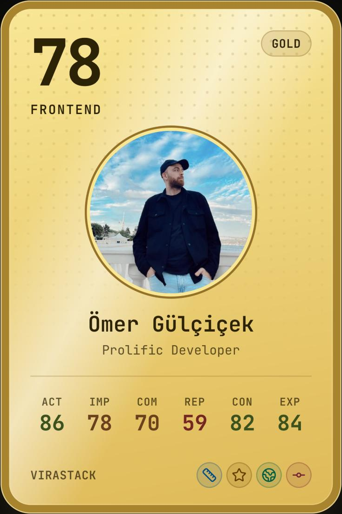

  

# Gitscout

**Turn any GitHub profile into a collectible card and see where it ranks.**

Type a GitHub username and Gitscout reads the public profile: contributions, repos, stars, followers and merged pull requests. A few seconds later you get a card with an overall rating, six stats, a role and a spot on the leaderboard.

- **Six stats:** Activity, Impact, Community, Reputation, Consistency and Experience, each from 0 to 100.
- **Card tiers:** Icon (90+), Gold (75–89), Silver (65–74), Bronze (0–64).
- **Role, title and badges:** Your role comes from the languages you use; your title from your strongest stat.
- **Duels:** Pick two developers and compare them stat by stat.

Scores come from simple formulas, not AI. They measure visible GitHub activity, not how good a developer is.

## Privacy

Everything comes from GitHub's public API. Private repos are never read and no contact details are stored. Anyone can add any username; if you'd rather not be listed, [open an issue](https://github.com/omergulcicek/gitscout/issues/new) and your card will be removed.

---

Made by [Ömer Gülçiçek](https://github.com/omergulcicek).
